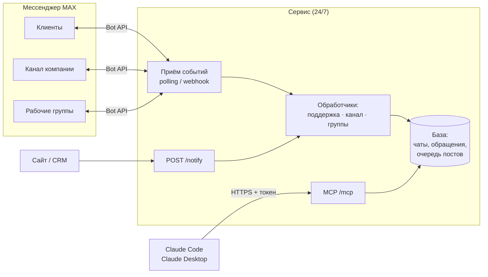

<div align="center">

# MAX Corporate

**Корпоративный аккаунт компании в мессенджере MAX — канал, поддержка и рабочие группы в одном сервисе.**

[](docs/brief.md)
[](https://dev.max.ru/docs-api)
[](https://modelcontextprotocol.io/)
[](LICENSE)

[Бриф и вопросы](docs/brief.md) · [Как это работает](#как-это-работает) · [Дорожная карта](#дорожная-карта)

</div>

---

Сервис подключается к MAX как бот компании и берёт на себя рутину: публикует посты в канал, принимает обращения клиентов и передаёт их операторам, рассылает уведомления по рабочим группам. Управлять всем можно обычным текстом через Claude.

Работает **только через официальный [MAX Bot API](https://dev.max.ru/docs-api)**. Никаких неофициальных клиентов личного аккаунта — значит, нет риска блокировки.

> [!IMPORTANT]
> Проект на стадии сбора требований. Если вы будете запускать сервис — начните с **[docs/brief.md](docs/brief.md)**: там схема работы, варианты хостинга и вопросы, на которые нужно ответить до старта разработки.

## Возможности

| | Что умеет | Зачем |
|---|---|---|
| 📣 **Канал** | посты с медиа и кнопками, отложенная публикация, согласование черновиков, закрепы, модерация комментариев | канал ведётся по плану, без ручной рутины |
| 💬 **Поддержка** | клиент пишет боту → карточка обращения в группе операторов → оператор отвечает реплаем → ответ уходит клиенту | операторы работают в привычном мессенджере, ни одно обращение не теряется |
| 👥 **Рабочие группы** | уведомления из сайта, CRM и других систем через HTTP, управление участниками и админами | события компании приходят туда, где их ждут |
| 🤖 **Claude (MCP)** | «опубликуй пост», «что пришло в поддержку за день», «ответь клиенту #42» | управление на естественном языке с подтверждением опасных действий |

## Как это работает



**Почему нужен отдельный постоянно работающий сервис.** События бота (сообщения, комментарии, нажатия кнопок) MAX отдаёт одному получателю. Кто-то должен забирать их круглосуточно — иначе обращение клиента пропадёт. Тот же сервис хранит список чатов бота: MAX с 2026 года не отдаёт его через API.

**Сценарий поддержки:**

1. Клиент пишет боту, сервис открывает обращение `#42`.
2. В группе операторов появляется карточка с кнопками **«Взять»** и **«Закрыть»**.
3. Оператор отвечает реплаем на карточку — бот отправляет текст клиенту от имени компании.
4. Claude видит все обращения и может сделать сводку или ответить сам после подтверждения.

Подробно — в [брифе](docs/brief.md#2-как-это-работает).

## Требования для запуска

| | |
|---|---|
| **Аккаунт** | юрлицо РФ, верифицированное в [MAX для бизнеса](https://business.max.ru), и созданный бот с токеном |
| **Сервер** | 1 vCPU, 1 ГБ RAM, 10 ГБ диска; рекомендуется VPS в РФ ([варианты](docs/brief.md#4-где-будет-работать-сервис)) |
| **ПО** | Node.js 22+ или Docker, корневой сертификат Минцифры |
| **Сеть** | домен с HTTPS — для режима webhook (для polling не нужен) |

## Стек

| Слой | Технологии |
|---|---|
| Язык | TypeScript, Node.js 22 |
| MAX | [`@maxhub/max-bot-api`](https://github.com/max-messenger/max-bot-api-client-ts) — официальный SDK |
| Claude | [`@modelcontextprotocol/sdk`](https://github.com/modelcontextprotocol/typescript-sdk), Streamable HTTP |
| Хранение | SQLite → Postgres при росте |
| Деплой | Docker |

## Дорожная карта

- [x] Исследование Bot API и готовых решений
- [x] [Бриф и список вопросов](docs/brief.md)
- [ ] **Этап 0.** Ответы на вопросы, верификация, создание бота
- [ ] **Этап 1.** Приём событий, база, реестр чатов, MCP «только чтение»
- [ ] **Этап 2.** Бот поддержки через группу операторов
- [ ] **Этап 3.** Канал: публикация, согласование, очередь, модерация
- [ ] **Этап 4.** Уведомления в группы, управление участниками
- [ ] **Этап 5.** Деплой, webhook, бэкапы, мониторинг

## Структура репозитория

```
.
├── README.md
├── LICENSE
└── docs/
    └── brief.md      # схема работы, хостинг, вопросы к заказчику
```

Код появится после этапа 0.

## Полезные ссылки

- [Документация MAX Bot API](https://dev.max.ru/docs-api)
- [OpenAPI-схема API](https://github.com/max-messenger/api-schema)
- [Официальный SDK на TypeScript](https://github.com/max-messenger/max-bot-api-client-ts)
- [Навык MAX для AI-агентов](https://github.com/max-messenger/max-agents-skill)
- [Кабинет «MAX для бизнеса»](https://business.max.ru)

## Лицензия

[MIT](LICENSE)
